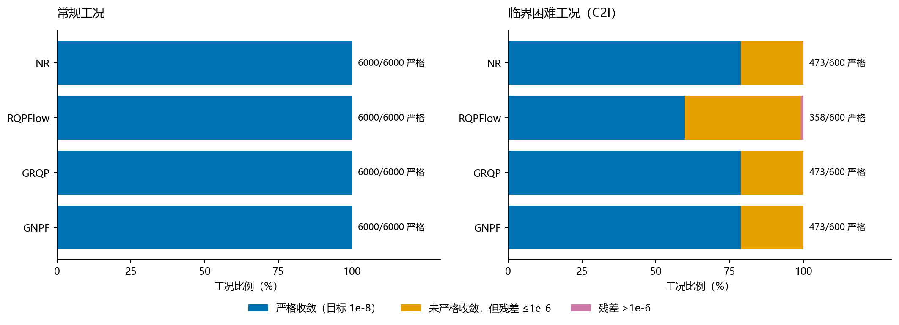
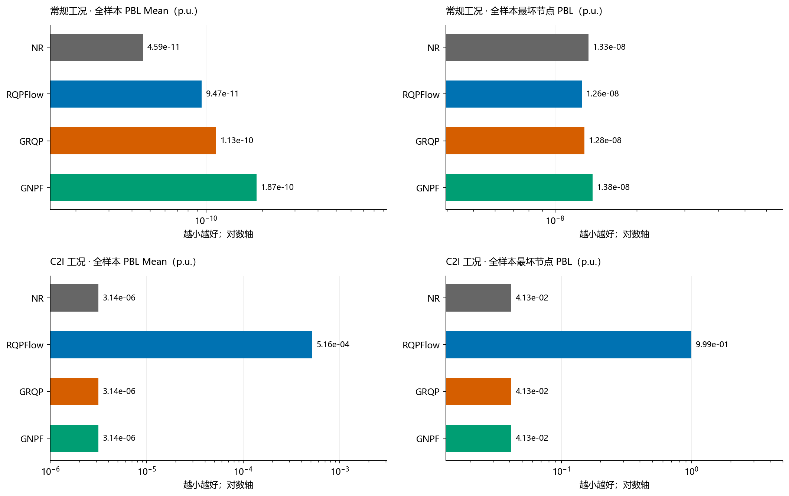
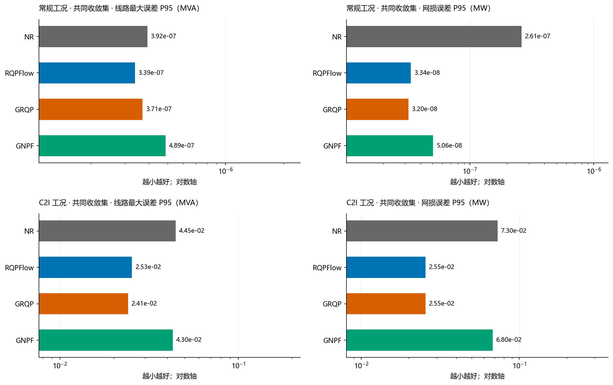
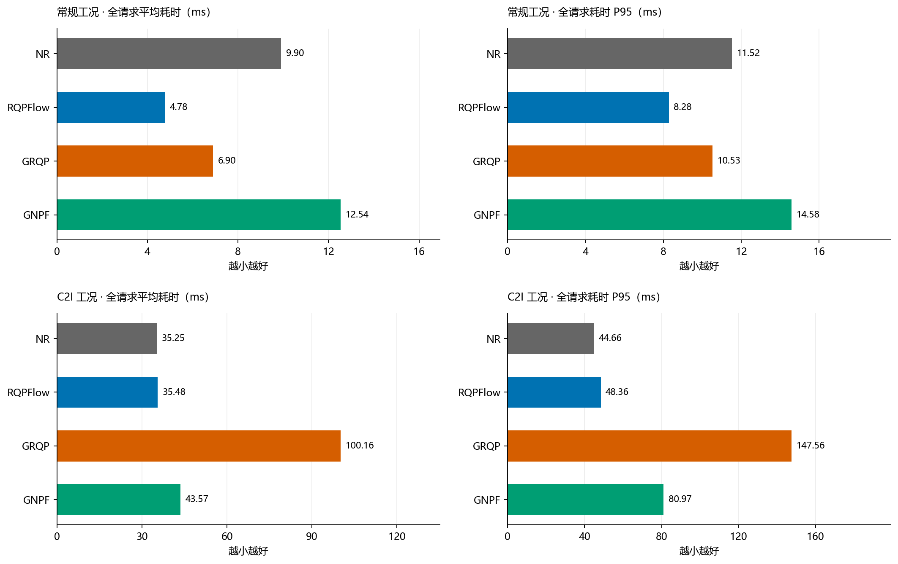
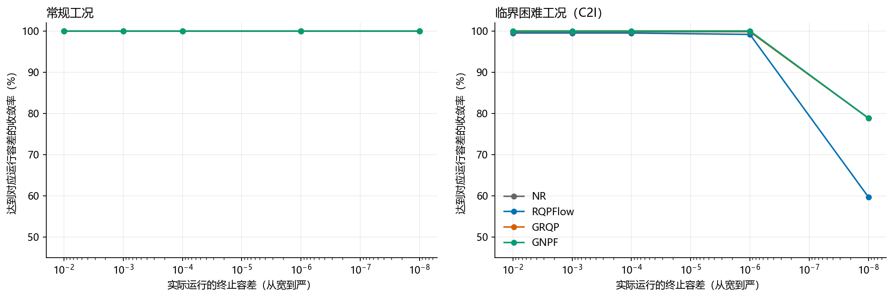

# 四种潮流求解器的四维对比

NR / RQPFlow / GRQP / GNPF · 收敛、节点 PBL、边损失、求解时间

2026-10-17 · case118 · Task 1.3 测试协议 · seed 11 · 既有结果补充分析

> **比较口径更正：本页为训练条件不同的历史系统测量，不是完整同任务的模型排名。** GRQP 使用 Task 1.3 feasible 子集（18,000 条）；GNPF 使用 Task 4.2 混合训练数据（48,600 条，含 C2I 与 approaching）。测试集合、硬件和目标容差相同，但训练数量、分布和训练预算不同。下列快慢与误差仅描述这几个既有 checkpoint。统一 Task 4.2、相同训练/验证样本、seed 11、固定 8 轮的新实验见 [统一训练条件重跑报告](matched_task42/REPORT.md)。

## 1. 先看结果

**常规工况优先看 RQPFlow：四种方法均为 6,000/6,000 收敛，它的平均耗时为 4.78 ms，约为 NR 的 48.3%。临界困难工况优先看 NR：NR、GRQP、GNPF 的严格收敛数均为 473/600，NR 的平均耗时最低，GRQP 约耗时 2.84 倍。** RQPFlow 在困难工况下与 NR 耗时接近，但严格收敛数降为 358/600。

下表的“严格收敛”指主实验目标容差为 `1e-8 p.u.` 时返回的收敛标志；“残差≤1e-6”是对同一次运行最终状态的补充统计。平均耗时包含失败、网络推理和回退。节点 PBL 为全部请求的统计，包括未收敛状态。

| 工况 | 方法 | 严格收敛 | 严格收敛率 | 残差≤1e-6 | 平均耗时 ms | 全样本 PBL Mean |
| --- | --- | --- | --- | --- | --- | --- |
| 常规工况 | NR | 6000/6000 | 100.00% | 6000/6000 | 9.90 | 4.59e-11 |
| 常规工况 | RQPFlow | 6000/6000 | 100.00% | 6000/6000 | 4.78 | 9.47e-11 |
| 常规工况 | GRQP | 6000/6000 | 100.00% | 6000/6000 | 6.90 | 1.13e-10 |
| 常规工况 | GNPF | 6000/6000 | 100.00% | 6000/6000 | 12.54 | 1.87e-10 |
| 临界困难工况（C2I） | NR | 473/600 | 78.83% | 599/600 | 35.25 | 3.14e-06 |
| 临界困难工况（C2I） | RQPFlow | 358/600 | 59.67% | 595/600 | 35.48 | 5.16e-04 |
| 临界困难工况（C2I） | GRQP | 473/600 | 78.83% | 599/600 | 100.16 | 3.14e-06 |
| 临界困难工况（C2I） | GNPF | 473/600 | 78.83% | 599/600 | 43.57 | 3.14e-06 |

| 维度 | 常规工况的主要差别 | 临界困难工况的主要差别 |
| --- | --- | --- |
| 收敛 | 四者全部收敛，覆盖 N / N-1 / N-2 | NR = GRQP = GNPF，RQPFlow 少 115 个严格收敛工况 |
| 节点 PBL | 全样本 PBL Mean 为 4.59e-11～1.87e-10 p.u.；四者最坏节点 PBL 都约为 1e-8 p.u. | 全样本均值被少量失败放大；RQPFlow 的异常尾部更大 |
| 边损失 | 共同收敛集合上，线路误差 P95 均小于 5e-7 MVA | 严格收敛也可能有约 0.61 MVA 线路差异；失败样本达到数百 MVA |
| 求解时间 | RQPFlow 4.78 < GRQP 6.90 < NR 9.90 < GNPF 12.54 ms | NR 35.25 ≈ RQPFlow 35.48 < GNPF 43.57 < GRQP 100.16 ms |

## 2. 实验范围与读表方式

本报告直接读取 `1017` 目录对应的原始产物，新增汇总、图表和报告，没有重新训练或运行求解器。

| 项目 | 本次比较口径 |
| --- | --- |
| 电网与测试协议 | IEEE case118，PFDelta Task 1.3 测试集；测试协议不代表所有神经 checkpoint 都按 Task 1.3 训练 |
| 常规 feasible | N / N-1 / N-2 各 2,000，共 6,000；读取 processed 输入 |
| 临界困难 C2I | N / N-1 / N-2 各 200，共 600；读取 raw FP64 输入 |
| 方法 | NR 平坦初值；RQPFlow v2；GRQP GNN 初值及后续数值尝试；GNPF 三步 NR prompt、GNN 方向及数值修正 |
| GRQP checkpoint | `runs/grqp_case118/seed11/best.pt` |
| GNPF checkpoint | `runs/gnpf_case118/seed11/best.pt`；本报告的 GNPF 为该网络版本 |
| RQPFlow / GRQP 缓存参考点 | feasible N 的训练集 `train[0]`，构建时间排除在请求耗时外 |
| 主实验容差 | `1e-8 p.u.`；NR `max_outer=40`，RQPFlow / GRQP / GNPF 的对应配置预算为 40 |
| 多阶段预算 | GRQP 每阶段有各自预算，最终 NR 回退也有预算；40 不是各方法统一的总迭代上限 |
| 数值与硬件 | CPU FP64 数值计算，网络 FP32 CPU；batch=1，BLAS / Torch 单线程；Windows 11；Intel64 Family 6 Model 198 Stepping 2, GenuineIntel |
| 计时 | 方法顺序轮换；预热不计；包含请求内推理、失败、重试阶段和回退，排除数据加载、参考解构建与指标计算 |
| 参考状态 | 数据集标签电压起步的 NR，目标 `1e-11`，必要时平坦起步，取残差更小者；在计时区间外计算 |
| 代码基准 | 既有实验记录为 `823fa4f1a25084ef21ed39536d157c23b28aeead` 加本目录 `code/` 脚本；本次只补充派生分析 |

精度表采用两种样本集合。**全样本**展示所有请求的终态误差，用来暴露失败尾部；**共同严格收敛集**只保留四种方法都严格收敛的相同工况，常规为 6,000 个，C2I 为 358 个。后一集合适合比较收敛后的数值精度，收敛覆盖范围由前一张表单独衡量。按方法自身收敛集合的完整统计也保存在派生 CSV 中。

所有 P95 都是工况间的经验 95 分位数；“最坏”取工况间最大值。没有缺失终态指标的请求。feasible 与 C2I 全程分别汇总。

## 3. 收敛情况：常规一致，困难工况拉开差距



蓝色表示严格收敛，橙色表示未严格收敛但终态残差已不超过 `1e-6`，粉色表示终态残差仍超过 `1e-6`。右侧数字为严格收敛数。橙色区域揭示了“未达到 1e-8”和“残差仍然很大”的区别。

下面每个拓扑单元格为“严格收敛数 / 最终残差≤1e-6 数”。常规每拓扑的分母为 2,000，C2I 每拓扑为 200。

| 工况 | 方法 | N：严格 / ≤1e-6 | N-1：严格 / ≤1e-6 | N-2：严格 / ≤1e-6 | 未严格收敛数 | >1e-6 数 |
| --- | --- | --- | --- | --- | --- | --- |
| 常规工况 | NR | 2000 / 2000 | 2000 / 2000 | 2000 / 2000 | 0 | 0 |
| 常规工况 | RQPFlow | 2000 / 2000 | 2000 / 2000 | 2000 / 2000 | 0 | 0 |
| 常规工况 | GRQP | 2000 / 2000 | 2000 / 2000 | 2000 / 2000 | 0 | 0 |
| 常规工况 | GNPF | 2000 / 2000 | 2000 / 2000 | 2000 / 2000 | 0 | 0 |
| 临界困难工况（C2I） | NR | 160 / 200 | 153 / 200 | 160 / 199 | 127 | 1 |
| 临界困难工况（C2I） | RQPFlow | 119 / 200 | 125 / 198 | 114 / 197 | 242 | 5 |
| 临界困难工况（C2I） | GRQP | 160 / 200 | 153 / 200 | 160 / 199 | 127 | 1 |
| 临界困难工况（C2I） | GNPF | 160 / 200 | 153 / 200 | 160 / 199 | 127 | 1 |

NR、GRQP、GNPF 在 C2I 下均有 127 个未严格收敛，其中 126 个已经达到 `1e-6`，剩余 1 个残差明显偏大。RQPFlow 有 242 个未严格收敛，其中 237 个达到 `1e-6`，其余 5 个超过该值。RQPFlow 的严格收敛率为 59.67%，其余三者为 78.83%，相差 19.17 个百分点。

### 3.1 单列残差超过 1e-6 的样本

| 拓扑 | 样本 | 方法 | 终态残差 p.u. | 最坏节点 PBL p.u. | 线路最大误差 MVA | 网损误差 MW |
| --- | --- | --- | --- | --- | --- | --- |
| N-1 | raw[0]:sample_10080_nose.json | RQPFlow | 1.16e-06 | 1.16e-06 | 0.001 | 0.001 |
| N-1 | raw[190]:sample_9047_nose.json | RQPFlow | 9.28e-01 | 9.28e-01 | 230.628 | 257.770 |
| N-2 | raw[103]:sample_18749_nose.json | GNPF | 3.72e-02 | 4.13e-02 | 264.109 | 342.119 |
| N-2 | raw[103]:sample_18749_nose.json | GRQP | 3.72e-02 | 4.13e-02 | 264.109 | 342.119 |
| N-2 | raw[103]:sample_18749_nose.json | NR | 3.72e-02 | 4.13e-02 | 264.109 | 342.119 |
| N-2 | raw[103]:sample_18749_nose.json | RQPFlow | 9.82e-01 | 9.99e-01 | 329.185 | 426.989 |
| N-2 | raw[110]:sample_19715_nose.json | RQPFlow | 1.07e-06 | 1.09e-06 | 0.000 | 0.000 |
| N-2 | raw[72]:sample_15899_nose.json | RQPFlow | 9.44e-01 | 9.61e-01 | 287.948 | 369.049 |

NR、GRQP、GNPF 的共同困难点是 N-2 的 `raw[103]:sample_18749_nose.json`，残差约 0.0372 p.u.，线路最大误差约 264 MVA，全网网损误差约 342 MW。RQPFlow 在该点以及另外两个样本上出现更大的残差；另两个超过 `1e-6` 的点只是略高于该阈值。不能把这五个点都解释为同等程度的失败。

GRQP 和 GNPF 有数值修正及 NR 回退机制。从实现可知这能在前级尝试未通过时继续求解；本批结果最终达到与 NR 相同的严格收敛数。原始文件没有保存逐阶段用时和最终阶段标识，因此本报告不推算回退触发率，也不将全部额外耗时归因于网络推理。

## 4. 节点 PBL：同时看平均节点和最坏节点

节点复功率不平衡定义为 `PBL_i = sqrt(ΔP_i² + ΔQ_i²)`，单位 p.u.。每个工况先得到节点均值 `PBL Mean` 与节点最大值 `PBL Max`，再跨工况统计。下表四列依次是：工况 PBL Mean 的均值、工况 PBL Max 的均值、工况 PBL Max 的 P95、全部工况中最大的节点 PBL。

求解终止判定使用 PF 方程残差的无穷范数；PBL 把 ΔP 和 ΔQ 合成复功率幅值。两者定义不同，因此严格收敛时最坏节点 PBL 可以略高于 `1e-8`。



图中均为全样本统计，横轴为对数轴。困难工况的均值受失败尾部显著影响，不能用均值替代最坏节点指标。

| 工况 | 方法 | PBL Mean | PBL Max 均值 | PBL Max P95 | 最坏节点 PBL |
| --- | --- | --- | --- | --- | --- |
| 常规工况 | NR | 4.59e-11 | 1.59e-09 | 7.09e-09 | 1.33e-08 |
| 常规工况 | RQPFlow | 9.47e-11 | 1.37e-09 | 7.43e-09 | 1.26e-08 |
| 常规工况 | GRQP | 1.13e-10 | 1.56e-09 | 7.84e-09 | 1.28e-08 |
| 常规工况 | GNPF | 1.87e-10 | 2.05e-09 | 8.52e-09 | 1.38e-08 |
| 临界困难工况（C2I） | NR | 3.14e-06 | 6.89e-05 | 3.13e-08 | 4.13e-02 |
| 临界困难工况（C2I） | RQPFlow | 5.16e-04 | 4.81e-03 | 6.05e-07 | 9.99e-01 |
| 临界困难工况（C2I） | GRQP | 3.14e-06 | 6.89e-05 | 3.13e-08 | 4.13e-02 |
| 临界困难工况（C2I） | GNPF | 3.14e-06 | 6.89e-05 | 3.13e-08 | 4.13e-02 |

常规工况中，NR 的平均 PBL 最低，但四者已处于很小的数值误差范围。困难工况中，RQPFlow 的 PBL Mean 约为 NR 的 164 倍，最坏节点约 0.999 p.u.；NR、GRQP、GNPF 的全样本最坏节点均约 0.0413 p.u.。三者均值非常接近，与它们拥有同一个明显困难点的结果一致。

### 4.1 固定在四者共同收敛的工况上

| 工况 | 方法 | 共同收敛数 | PBL Mean | PBL Max 均值 | 最坏节点 PBL |
| --- | --- | --- | --- | --- | --- |
| 常规工况 | NR | 6000 | 4.59e-11 | 1.59e-09 | 1.33e-08 |
| 常规工况 | RQPFlow | 6000 | 9.47e-11 | 1.37e-09 | 1.26e-08 |
| 常规工况 | GRQP | 6000 | 1.13e-10 | 1.56e-09 | 1.28e-08 |
| 常规工况 | GNPF | 6000 | 1.87e-10 | 2.05e-09 | 1.38e-08 |
| 临界困难工况（C2I） | NR | 358 | 1.46e-10 | 4.57e-09 | 1.21e-08 |
| 临界困难工况（C2I） | RQPFlow | 358 | 2.31e-10 | 3.20e-09 | 1.03e-08 |
| 临界困难工况（C2I） | GRQP | 358 | 2.31e-10 | 3.17e-09 | 1.03e-08 |
| 临界困难工况（C2I） | GNPF | 358 | 1.49e-10 | 4.71e-09 | 1.20e-08 |

这组表回答“在同一批都能解出的工况上，谁的终态残差更小”。C2I 的全样本大误差与共同收敛集的微小 PBL 同时存在，说明评价求解器时必须把覆盖率和收敛后精度分开。共同集合由四者表现共同筛选，不能代表全部 600 个困难工况。

当前原始产物只保存每个工况的节点 PBL 汇总，没有逐节点残差向量，因此这里可以比较节点误差水平与最坏节点幅值，不能进一步定位误差最大的节点编号或绘制逐节点热力图。

## 5. 边损失：线路潮流误差与有功网损误差

现有产物记录了线路误差和全网网损误差，本报告分别展示这两个含义：

- **线路潮流误差**：每条线路计算两端视在功率幅值误差，取两端较大者，乘 `baseMVA=100`，单位 MVA。先取一个工况里误差最大的线路，再计算工况间的中位数、P95 与最坏值。它测量的是幅值差，没有包含复功率相角差。
- **全网有功网损误差**：`abs(Σ线路(P_from + P_to) − 参考状态的对应总和) × 100`，单位 MW。它是总网损的绝对误差；已有产物没有逐条线路有功损耗误差，无法从总网损误差推得最坏单线路损耗误差。
- **负载率与过载判断**：以两端较大的视在功率幅值除以该线路额定值；负载率误差用百分点，过载门槛为 100%。数据集生成没有强制满足这些限额，漏判/误报衡量与参考状态判断的一致性。

### 5.1 同样的共同收敛集合



图中比较的是四者相同工况集合上的 P95，两列分别为线路最大幅值误差与全网有功网损误差；横轴为对数轴。

下表“线路均值”先在一个工况内对线路误差求均值，再跨工况求均值；其他线路列先在工况内取最大线路误差，再跨工况统计。

| 工况 | 方法 | 共同收敛数 | 线路均值 MVA | 工况最大误差中位数 MVA | P95 MVA | 最坏 MVA | 网损误差 P95 MW | 最坏网损误差 MW |
| --- | --- | --- | --- | --- | --- | --- | --- | --- |
| 常规工况 | NR | 6000 | 9.94e-09 | 1.02e-08 | 3.92e-07 | 1.37e-03 | 2.61e-07 | 5.29e-04 |
| 常规工况 | RQPFlow | 6000 | 5.09e-09 | 4.04e-09 | 3.39e-07 | 4.05e-04 | 3.34e-08 | 1.57e-04 |
| 常规工况 | GRQP | 6000 | 4.98e-09 | 6.29e-09 | 3.71e-07 | 1.98e-04 | 3.20e-08 | 7.66e-05 |
| 常规工况 | GNPF | 6000 | 6.19e-09 | 3.60e-08 | 4.89e-07 | 2.28e-05 | 5.06e-08 | 8.81e-06 |
| 临界困难工况（C2I） | NR | 358 | 9.79e-04 | 7.57e-03 | 4.45e-02 | 6.13e-01 | 7.30e-02 | 8.04e-01 |
| 临界困难工况（C2I） | RQPFlow | 358 | 5.86e-04 | 4.11e-04 | 2.53e-02 | 6.13e-01 | 2.55e-02 | 7.98e-01 |
| 临界困难工况（C2I） | GRQP | 358 | 5.85e-04 | 4.11e-04 | 2.41e-02 | 6.13e-01 | 2.55e-02 | 7.98e-01 |
| 临界困难工况（C2I） | GNPF | 358 | 9.84e-04 | 8.38e-03 | 4.30e-02 | 6.13e-01 | 6.80e-02 | 8.08e-01 |

常规工况中，四种方法的线路误差 P95 都低于 `5e-7 MVA`。其最坏样本仍有差别，但都小于 `0.002 MVA`。C2I 中，即使节点残差通过严格校验，线路结果也可能与参考状态出现约 `0.61 MVA` 的差异：临界状态对电压的敏感性较高，小残差并不直接约束与某个参考解的距离。

参考状态本身也需结合其质量解释：常规 6,000 个参考解都达到 `1e-11`；C2I 只有 321/600 达到该目标，最坏参考残差约 `1.00e-7 p.u.`。因此困难工况中的线路差异应读作“与当前最佳参考状态的差异”，不能全部归因为待评方法错误。

共同收敛集合上的负载率与过载判断如下。漏判/误报按“线路 × 工况”累计，最重载识别率按工况统计。

| 工况 | 方法 | 负载率误差 P95 百分点 | 最坏 百分点 | 过载漏判 次 | 过载误报 次 | 最重载线路识别率 |
| --- | --- | --- | --- | --- | --- | --- |
| 常规工况 | NR | 1.82e-07 | 7.68e-04 | 0 | 0 | 100.00% |
| 常规工况 | RQPFlow | 1.90e-07 | 2.27e-04 | 0 | 0 | 100.00% |
| 常规工况 | GRQP | 2.09e-07 | 1.11e-04 | 0 | 0 | 100.00% |
| 常规工况 | GNPF | 3.02e-07 | 1.28e-05 | 0 | 0 | 100.00% |
| 临界困难工况（C2I） | NR | 1.79e-02 | 2.10e-01 | 0 | 0 | 100.00% |
| 临界困难工况（C2I） | RQPFlow | 1.29e-02 | 2.09e-01 | 0 | 0 | 100.00% |
| 临界困难工况（C2I） | GRQP | 1.29e-02 | 2.09e-01 | 0 | 0 | 100.00% |
| 临界困难工况（C2I） | GNPF | 1.75e-02 | 2.11e-01 | 0 | 0 | 100.00% |

### 5.2 把失败终态也计入，观察风险尾部

| 工况 | 方法 | 线路误差 P95 MVA | 最坏线路误差 MVA | 网损误差中位数 MW | 网损误差 P95 MW | 最坏网损误差 MW |
| --- | --- | --- | --- | --- | --- | --- |
| 常规工况 | NR | 3.92e-07 | 1.37e-03 | 3.20e-09 | 2.61e-07 | 5.29e-04 |
| 常规工况 | RQPFlow | 3.39e-07 | 4.05e-04 | 2.35e-10 | 3.34e-08 | 1.57e-04 |
| 常规工况 | GRQP | 3.71e-07 | 1.98e-04 | 3.10e-10 | 3.20e-08 | 7.66e-05 |
| 常规工况 | GNPF | 4.89e-07 | 2.28e-05 | 1.36e-09 | 5.06e-08 | 8.81e-06 |
| 临界困难工况（C2I） | NR | 3.97e-02 | 2.64e+02 | 8.11e-03 | 6.46e-02 | 3.42e+02 |
| 临界困难工况（C2I） | RQPFlow | 1.19e-02 | 3.29e+02 | 5.45e-04 | 1.41e-02 | 4.27e+02 |
| 临界困难工况（C2I） | GRQP | 3.22e-02 | 2.64e+02 | 7.78e-04 | 5.65e-02 | 3.42e+02 |
| 临界困难工况（C2I） | GNPF | 3.89e-02 | 2.64e+02 | 8.50e-03 | 5.40e-02 | 3.42e+02 |

这张表覆盖全部请求。RQPFlow 的困难工况最坏线路误差约 329 MVA、最坏网损误差约 427 MW；其余三者分别约 264 MVA 和 342 MW。网损误差的中位数可能很小，但无法体现这类少量异常；实际使用必须结合收敛标志与尾部指标。

同样，不能用 RQPFlow 自身更少的收敛样本上较小的线路 P95，直接宣称其线路精度优于 NR。本报告主精度比较固定为共同集合，完整派生表另保留各方法自身收敛集合。

## 6. 求解时间：比较完整请求成本



均值反映整批计算成本，P95 表示 95% 的请求能在该时间以内完成。两者都包含失败请求及请求内回退。

| 工况 | 方法 | 均值 ms | 中位数 ms | P95 ms | 最慢 ms | 总耗时 s | 耗时/NR [95%区间] |
| --- | --- | --- | --- | --- | --- | --- | --- |
| 常规工况 | NR | 9.90 | 10.00 | 11.52 | 34.24 | 59.37 | 1.000（基准） |
| 常规工况 | RQPFlow | 4.78 | 4.27 | 8.28 | 20.84 | 28.65 | 0.483 [0.477, 0.488] |
| 常规工况 | GRQP | 6.90 | 6.40 | 10.53 | 166.54 | 41.39 | 0.697 [0.690, 0.706] |
| 常规工况 | GNPF | 12.54 | 12.06 | 14.58 | 31.10 | 75.24 | 1.267 [1.263, 1.271] |
| 临界困难工况（C2I） | NR | 35.25 | 33.80 | 44.66 | 57.17 | 21.15 | 1.000（基准） |
| 临界困难工况（C2I） | RQPFlow | 35.48 | 34.65 | 48.36 | 95.33 | 21.29 | 1.007 [0.987, 1.026] |
| 临界困难工况（C2I） | GRQP | 100.16 | 95.09 | 147.56 | 304.35 | 60.10 | 2.841 [2.778, 2.905] |
| 临界困难工况（C2I） | GNPF | 43.57 | 35.26 | 80.97 | 95.30 | 26.14 | 1.236 [1.207, 1.266] |

“耗时/NR”小于 1 表示比 NR 快，大于 1 表示更慢。区间来自已有逐工况配对 bootstrap，重采样 2,000 次、seed 11，表示当前样本集合上的变化范围；不是重复计时实验的波动区间。

常规工况下，RQPFlow 比 NR 平均少用 5.12 ms，请求耗时缩短 51.7%，对应约 2.07 倍吞吐；GRQP 比 NR 缩短 30.3%，但比 RQPFlow 慢约 44.5%。GNPF 比 NR 多用 26.7%，当前网络方向没有带来整条求解链路的加速。

困难工况下，RQPFlow 与 NR 的平均耗时比为 1.007，区间覆盖 1；这次测量看不到清晰的耗时优势，同时其收敛覆盖率更低。GRQP 平均比 NR 多用 64.91 ms、耗时约 2.84 倍。GNPF 比 NR 多用 8.32 ms，平均耗时增加 23.6%；其 P95 也明显高于 NR。

GRQP 的多级尝试和 GNPF 的方向计算、子空间修正会引入额外工作，这是实现机制；本批原始结果只保留请求总耗时，不能据此拆分各阶段成本。也不能用不同方法的 `iterations` 列当作完全相同的工作量单位。

## 7. 容差变化：单独重跑的结果

这一节读取既有 `tolerance_sweep.json` 派生表。常规每拓扑取 300 个，共 900 个；C2I 为全部 600 个。每个容差是独立运行的终止条件，和前文“1e-8 运行结束后再检查是否≤1e-6”是两种统计。



表内格式为“对应运行容差下的收敛数/样本数 · 全请求平均 ms”。

| 工况 | 运行容差 | 样本数/方法 | NR | RQPFlow | GRQP | GNPF |
| --- | --- | --- | --- | --- | --- | --- |
| 常规工况 | 1e-02 | 900 | 900/900 · 6.54 ms | 900/900 · 2.59 ms | 900/900 · 4.44 ms | 900/900 · 6.67 ms |
| 常规工况 | 1e-03 | 900 | 900/900 · 6.98 ms | 900/900 · 2.99 ms | 900/900 · 4.87 ms | 900/900 · 7.77 ms |
| 常规工况 | 1e-04 | 900 | 900/900 · 8.61 ms | 900/900 · 3.36 ms | 900/900 · 5.23 ms | 900/900 · 11.62 ms |
| 常规工况 | 1e-06 | 900 | 900/900 · 8.71 ms | 900/900 · 4.07 ms | 900/900 · 6.00 ms | 900/900 · 11.83 ms |
| 常规工况 | 1e-08 | 900 | 900/900 · 9.68 ms | 900/900 · 4.75 ms | 900/900 · 6.72 ms | 900/900 · 12.19 ms |
| 临界困难工况（C2I） | 1e-02 | 600 | 599/600 · 12.21 ms | 597/600 · 22.46 ms | 599/600 · 51.73 ms | 600/600 · 14.35 ms |
| 临界困难工况（C2I） | 1e-03 | 600 | 599/600 · 16.05 ms | 597/600 · 25.72 ms | 599/600 · 61.75 ms | 600/600 · 17.23 ms |
| 临界困难工况（C2I） | 1e-04 | 600 | 599/600 · 19.18 ms | 597/600 · 27.91 ms | 599/600 · 69.17 ms | 600/600 · 20.59 ms |
| 临界困难工况（C2I） | 1e-06 | 600 | 599/600 · 26.43 ms | 595/600 · 31.35 ms | 599/600 · 77.16 ms | 600/600 · 27.68 ms |
| 临界困难工况（C2I） | 1e-08 | 600 | 473/600 · 34.71 ms | 358/600 · 35.15 ms | 473/600 · 99.20 ms | 473/600 · 42.73 ms |

容差扫描还给出一个值得保留的差别：C2I 以 `1e-6` 为实际终止目标时，GNPF 达到 600/600，NR 和 GRQP 为 599/600，RQPFlow 为 595/600；对应 GNPF 平均 27.68 ms，NR 为 26.43 ms。也就是说，GNPF 在这一宽松目标下多解出 1 个工况，平均多用约 4.7% 时间。这个收益在严格 `1e-8` 主实验中没有保留。

这组结果用来判断更严格的精度目标如何改变耗时和覆盖率。常规扫描只用了主实验的一个子集，因此不要把扫描的绝对耗时变化全部解释为容差效应；应在同一张扫描表内部比较。前文严格收敛的主结论仍以完整 6,600 个请求为准。

## 8. N / N-1 / N-2 分项结果

下表把四个维度放在同一行。节点 PBL 和耗时统计全部请求；线路和网损列采用当前拓扑下四种方法的共同严格收敛集，C2I 分别为 119、125、114 个。收敛计数见第 3 节。

| 工况 | 拓扑 | 方法 | 全样本 PBL Mean | 全样本最坏节点 PBL | 共同收敛数 | 共同集线路误差 P95 MVA | 共同集网损误差 P95 MW | 平均 ms | P95 ms |
| --- | --- | --- | --- | --- | --- | --- | --- | --- | --- |
| 常规工况 | N | NR | 5.48e-11 | 1.33e-08 | 2000 | 5.00e-07 | 3.50e-07 | 9.87 | 11.30 |
| 常规工况 | N-1 | NR | 4.15e-11 | 1.17e-08 | 2000 | 3.41e-07 | 2.15e-07 | 9.94 | 11.90 |
| 常规工况 | N-2 | NR | 4.14e-11 | 1.09e-08 | 2000 | 3.65e-07 | 2.22e-07 | 9.87 | 11.30 |
| 常规工况 | N | RQPFlow | 9.73e-11 | 1.20e-08 | 2000 | 3.50e-07 | 3.96e-08 | 3.43 | 4.94 |
| 常规工况 | N-1 | RQPFlow | 9.28e-11 | 1.26e-08 | 2000 | 3.22e-07 | 2.93e-08 | 5.37 | 8.56 |
| 常规工况 | N-2 | RQPFlow | 9.40e-11 | 1.11e-08 | 2000 | 3.42e-07 | 2.89e-08 | 5.53 | 9.29 |
| 常规工况 | N | GRQP | 1.06e-10 | 1.20e-08 | 2000 | 3.62e-07 | 3.41e-08 | 5.47 | 6.78 |
| 常规工况 | N-1 | GRQP | 1.10e-10 | 1.28e-08 | 2000 | 3.66e-07 | 2.90e-08 | 7.62 | 10.91 |
| 常规工况 | N-2 | GRQP | 1.24e-10 | 1.26e-08 | 2000 | 3.97e-07 | 3.38e-08 | 7.61 | 11.80 |
| 常规工况 | N | GNPF | 2.30e-10 | 1.38e-08 | 2000 | 4.94e-07 | 6.88e-08 | 12.38 | 14.46 |
| 常规工况 | N-1 | GNPF | 1.52e-10 | 1.33e-08 | 2000 | 4.82e-07 | 3.41e-08 | 12.75 | 14.87 |
| 常规工况 | N-2 | GNPF | 1.78e-10 | 1.33e-08 | 2000 | 4.96e-07 | 4.43e-08 | 12.49 | 14.47 |
| 临界困难工况（C2I） | N | NR | 2.93e-10 | 5.49e-08 | 119 | 3.66e-02 | 6.39e-02 | 35.03 | 44.92 |
| 临界困难工况（C2I） | N-1 | NR | 2.66e-10 | 1.06e-07 | 125 | 5.59e-02 | 8.78e-02 | 35.94 | 44.69 |
| 临界困难工况（C2I） | N-2 | NR | 9.43e-06 | 4.13e-02 | 114 | 3.75e-02 | 6.42e-02 | 34.79 | 43.30 |
| 临界困难工况（C2I） | N | RQPFlow | 5.61e-09 | 8.00e-07 | 119 | 2.51e-02 | 1.79e-02 | 33.16 | 42.07 |
| 临界困难工况（C2I） | N-1 | RQPFlow | 5.24e-04 | 9.28e-01 | 125 | 4.88e-02 | 6.03e-02 | 36.59 | 50.97 |
| 临界困难工况（C2I） | N-2 | RQPFlow | 1.02e-03 | 9.99e-01 | 114 | 1.25e-02 | 1.26e-02 | 36.70 | 52.98 |
| 临界困难工况（C2I） | N | GRQP | 3.75e-10 | 5.49e-08 | 119 | 2.40e-02 | 1.79e-02 | 95.45 | 134.33 |
| 临界困难工况（C2I） | N-1 | GRQP | 3.11e-10 | 1.06e-07 | 125 | 4.88e-02 | 6.03e-02 | 101.87 | 155.73 |
| 临界困难工况（C2I） | N-2 | GRQP | 9.43e-06 | 4.13e-02 | 114 | 1.25e-02 | 1.26e-02 | 103.17 | 149.42 |
| 临界困难工况（C2I） | N | GNPF | 2.93e-10 | 5.49e-08 | 119 | 4.62e-02 | 6.07e-02 | 42.90 | 80.91 |
| 临界困难工况（C2I） | N-1 | GNPF | 2.67e-10 | 1.06e-07 | 125 | 5.39e-02 | 8.21e-02 | 44.76 | 81.04 |
| 临界困难工况（C2I） | N-2 | GNPF | 9.43e-06 | 4.13e-02 | 114 | 3.55e-02 | 5.55e-02 | 43.05 | 79.80 |

## 9. 既有系统表现的适用范围

| 使用情景 | 当前结果支持的选择 | 依据 |
| --- | --- | --- |
| 同规模常规工况，大量重复求解 | RQPFlow | 6,000 个全部收敛，平均耗时最低，线路误差很小；需要已有参考点与缓存 |
| 接近极限的困难工况 | NR 作为当前首选基准 | 与两个混合方法同样的收敛覆盖率，完整请求耗时更低 |
| 评估 GRQP 初值是否带来收益 | 先与 RQPFlow 比较 | 常规比 RQPFlow 慢，困难工况虽恢复更多收敛，但付出明显耗时；没有全面优于数值路线 |
| 评估 GNPF 方向是否带来收益 | 继续以 NR 作对照 | 本批覆盖率与 NR 相同，常规和困难平均耗时均更高 |
| 需要可信线路或网损输出 | 同时检查收敛、节点 PBL 和线路尾部 | 单看很小的误差中位数会漏掉数百 MVA / MW 的失败样本 |

上表只描述既有完整系统在 case118 与当前请求级 CPU 协议下的测量，不能据此认定 GRQP 与 GNPF 的网络设计优劣。模型比较应以统一训练数据重跑为准。

## 10. 数据、脚本与复现

- 原始主实验：[main_tol1e-8.json](../../../runs/client_pf_benchmark_20261017/main_tol1e-8.json)。
- 原始容差实验：[tolerance_sweep.json](../../../runs/client_pf_benchmark_20261017/tolerance_sweep.json)。
- 原始评测与指标定义：[run_benchmark.py](code/run_benchmark.py)；原报告协议：[README.md](README.md)。
- 本报告构建脚本：[build_four_method_report.py](code/build_four_method_report.py)，文字模板：[four_method_template.md](code/four_method_template.md)。
- 全部派生统计：[four_method_summary.csv](data/four_method_summary.csv)，包含全样本、各自收敛集、共同收敛集和逐拓扑统计。
- 四种方法逐请求指标：[four_method_requests.csv.gz](data/four_method_requests.csv.gz)，含原始残差、节点指标、线路指标、耗时与共同收敛标志。
- 参考质量：[reference_quality.csv](data/reference_quality.csv)；耗时区间：[paired_ratio_main.csv](data/paired_ratio_main.csv)。
- 图表：`figures/four_*.png` 与 `figures/four_*.svg`；HTML 已内嵌全部图片，可离线阅读。

从仓库根目录执行以下命令，只读取已有结果并重建补充报告：

```powershell
conda run -n torchx python docs/experiments/client_pf_benchmark_20261017/code/build_four_method_report.py
```

构建过程检查四种方法是否各覆盖相同的 6,600 个请求、是否有重复或缺失、收敛标志是否满足目标残差，以及新汇总是否与既有主表一致。数值表与图表由原始记录生成；本次没有新增评测测量。
