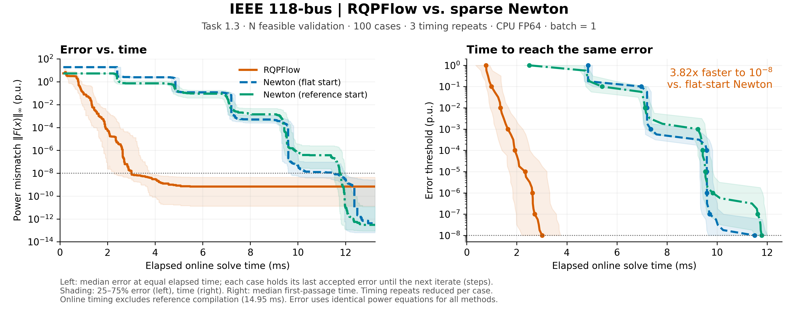

# RQPFlow：利用固定网络结构加速重复潮流计算

## 核心思路

在同一电网的多工况分析中，负荷和发电设定值会变化，而网络连接关系及线路参数通常保持不变。RQPFlow 利用这一特点，**将参考工况的雅可比矩阵 LU 分解缓存下来，在后续工况中重复使用**，降低传统牛顿法反复构造和分解雅可比矩阵的开销。当前实现为 CPU 双精度数值求解器，无需神经网络训练。

这里的固定结构具体要求：节点类型、支路连接与排序、支路参数、并联导纳保持一致；负荷、发电有功设定值、PV 节点电压幅值及平衡节点电压可以变化。此时网络导纳矩阵保持不变，为跨工况复用提供基础。

## 符号与单位

本文采用标幺制：电压、功率和导纳分别按基准电压、基准功率和基准导纳归一化，记为 p.u.；电压平方记为 p.u.²。标幺量在数值上无量纲，下表保留其物理类型以便理解。

| 符号 | 含义 | 单位或量纲 |
|---|---|---|
| \(\mathrm{j}\) | 虚数单位，\(\mathrm{j}^2=-1\) | 无量纲 |
| \(Y\) | 节点导纳矩阵，由支路参数及并联导纳确定 | 导纳 p.u. |
| \(V=e+\mathrm{j}f\) | 节点复电压；\(e,f\) 分别为实部、虚部 | 电压 p.u. |
| \(V_{\mathrm{ref}}\) | 参考工况的节点复电压 | 电压 p.u. |
| \(v^{\mathrm{spec}}\) | 输入指定的电压幅值 | 电压 p.u. |
| \(S=P+\mathrm{j}Q\) | 节点注入复功率；\(P,Q\) 分别为有功、无功 | 功率 p.u. |
| \(P^{\mathrm{spec}},Q^{\mathrm{spec}}\) | 输入指定的有功、无功注入 | 功率 p.u. |
| \(x\) | 非平衡节点电压实部、虚部拼接的未知向量 | 电压 p.u. |
| \(u\) | 当前工况的输入集合，包含功率、电压幅值和相角设定 | 混合：功率 p.u.、电压 p.u.、相角 rad |
| \(d,d_k\) | 电压状态的修正方向，\(k\) 表示迭代编号 | 电压 p.u. |
| \(w\) | 由实向量 \(d\) 还原的复电压增量，平衡节点分量为零 | 电压 p.u. |
| \(F(x;u)\) | 直角坐标方程残差，包含功率失配和 PV 电压平方失配 | 功率行：p.u.；电压平方行：p.u.² |
| \(J(x;u),J_{\mathrm{ref}}\) | 当前状态、参考状态的雅可比矩阵 \(\partial F/\partial x\) | 按行：功率 p.u./电压 p.u.，或电压 p.u.²/电压 p.u. |
| \(B\) | 当前请求采用的已分解雅可比，初始为 \(J_{\mathrm{ref}}\) | 同 \(J\) |
| \(L,U\) | 稀疏 LU 分解的下、上三角因子（由求解器处理置换） | 归一化矩阵的数值因子，不单独赋予物理单位 |
| \(b\) | 线性方程 \(J_{\mathrm{ref}}d=b\) 的右端项 | 与 \(F\) 各行一致 |
| \(Q(d,d)\) | 电压增量引起的二次项；与无功符号 \(Q\) 按是否带参数区分 | 与 \(F\) 各行一致 |
| \(\delta S\) | 沿电压增量 \(w\) 的复功率方向变化量 | 功率 p.u. |
| \(\alpha\) | 线搜索步长，实际状态增量为 \(\alpha d\) | 无量纲 |
| \(\rho_k\) | 相邻两轮归一化残差无穷范数之比 | 无量纲 |
| \(\mathrm{free},\mathrm{PQ},\mathrm{PV}\) | 非平衡节点、PQ 节点、PV 节点的索引集合 | 无单位 |
| \(\odot,\overline{(\cdot)},\operatorname{Re},\operatorname{Im}\) | 逐元素乘法、复共轭、取实部、取虚部 | 运算符 |
| \(\|\cdot\|_\infty\) | 向量分量绝对值的最大值 | 同被度量量；混合残差取归一化数值 |

**误差口径：** 内部 \(\|F\|_\infty\) 对功率行和电压平方行的标幺数值统一取最大值。实验图中的 err 仅统计输出状态的有功、无功失配，单位为功率 p.u.，不包含电压平方残差；两项收敛检查均采用数值阈值 \(10^{-8}\)。

## 模型设计

### 1. 将潮流方程写成固定结构的二次系统

设网络导纳矩阵为 \(Y\)，节点复电压为 \(V=e+\mathrm{j}f\)，节点注入复功率为

\[
S(V)=V\odot\overline{YV},
\]

其中 \(\odot\) 表示逐元素乘法。平衡节点电压由输入指定，其余节点的电压实部和虚部组成未知向量 \(x=[e_{\mathrm{free}};f_{\mathrm{free}}]\)。求解器按节点类型构造约束：

| 节点类型 | 输入指定量 | 纳入求解的方程 |
|---|---|---|
| PQ | 有功、无功注入 | 有功失配、无功失配为零 |
| PV | 有功注入、电压幅值 | 有功失配、电压幅值平方失配为零 |
| 平衡节点 | 电压幅值、相角 | 电压直接固定，不加入未知向量 |

因此，残差向量为

\[
F(x;u)=
\begin{bmatrix}
\operatorname{Re}S_{\mathrm{free}}(V)-P^{\mathrm{spec}}_{\mathrm{free}}\\
\operatorname{Im}S_{\mathrm{PQ}}(V)-Q^{\mathrm{spec}}_{\mathrm{PQ}}\\
|V_{\mathrm{PV}}|^2-(v^{\mathrm{spec}}_{\mathrm{PV}})^2
\end{bmatrix}.
\]

采用直角坐标后，这些约束均为二次方程，满足精确关系：

\[
F(x+d;u)=F(x;u)+J(x;u)d+Q(d,d),
\]

其中，\(u\) 表示当前运行工况，\(J\) 为雅可比矩阵，\(Q(d,d)\) 为电压增量产生的二次项。固定网络参数和节点类型使二次项的结构与系数保持一致；负荷与发电设定值主要改变方程右端，平衡节点电压变化还会影响消元后的线性项和常数项。

### 2. 参考点预计算：保存可重复使用的数值分解

先使用训练集首个样本的输入，通过稀疏牛顿法求得参考电压 \(V_{\mathrm{ref}}\)，再构造其直角坐标雅可比 \(J_{\mathrm{ref}}\)，缓存稀疏 LU 因子。该过程不使用数据集中的解标签。对后续每个工况，求解器检查节点类型、支路连接、支路参数和并联导纳是否与参考网络一致，然后复用参考电压与 LU 因子。

缓存的数值分解可用于反复求解 \(J_{\mathrm{ref}}d=b\)：每次只需利用已有因子完成三角求解，无需重新进行 LU 分解，也不显式构造逆矩阵。各请求始终从同一个参考缓存出发，不依赖前一工况的求解结果。

### 3. 在线求解：根据残差表现调整复用方式

初始电压由参考电压生成：按当前平衡节点相角旋转相应电气岛的电压，并将 PV 节点幅值调整为当前设定值；平衡节点电压在方程计算中直接使用当前输入。随后循环执行以下步骤：

1. **优先采用缓存分解修正。** 令当前缓存对应矩阵为 \(B\)，初始为 \(J_{\mathrm{ref}}\)，求解 \(Bd_k=-F(x_k;u)\)。这是固定雅可比的弦迭代，单步主要包含残差计算和已有 LU 因子的三角求解。
2. **收缩不足时使用当前雅可比修正。** 若上一轮残差比 \(\rho_k=\|F(x_k;u)\|_\infty/\|F(x_{k-1};u)\|_\infty>0.5\)，则以弦迭代方向为初值，用 GMRES 近似求解 \(J(x_k;u)d_k=-F(x_k;u)\)，并以缓存 LU 作为预条件器。这样可以利用当前状态的导数信息，同时避免每步重新分解当前雅可比。
3. **线搜索与必要时重新分解。** 从步长 \(\alpha=1\) 开始逐次减半，要求更新后残差满足 \(\|F(x_k+\alpha d_k;u)\|_\infty<(1-10^{-4}\alpha)\|F(x_k;u)\|_\infty\)。若候选方向无法通过线搜索，则构造并分解当前雅可比，再尝试更新。新因子仅在当前请求内复用，不修改跨工况共享的参考缓存。GMRES 未收敛时先退回弦迭代方向，再按同样的线搜索规则处理。

### 4. 解析矩阵—向量乘积与收敛检查

GMRES 只需要计算 \(Jd\)。将方向 \(d\) 还原为复电压增量 \(w\)，并令平衡节点增量为零，则功率的方向导数为

\[
\delta S=w\odot\overline{YV}+V\odot\overline{Yw}.
\]

取其对应节点的实部、虚部，再加上 PV 约束的方向导数 \(2\operatorname{Re}(\overline{V}_{\mathrm{PV}}\odot w_{\mathrm{PV}})\)，即可得到完整的 \(Jd\)。计算只涉及稀疏导纳矩阵与向量相乘及逐元素运算，无需显式组装当前雅可比。二次表示在此提供了解析导数结构；当前在线更新采用弦迭代和 Newton–GMRES 修正。

终止时同时检查直角坐标方程残差，以及恢复规定 PV 幅值后的输出状态功率残差，两者均需达到 \(10^{-8}\) 阈值。最终从电压恢复节点功率和支路两端复功率。当前配置最多进行 40 次外层迭代。

### 贯穿 1–4 的三节点计算例子

下面用一个便于手算的三节点网络说明上述过程，所有数值均为标幺值。1 号是平衡节点，2 号是 PV 节点，3 号是 PQ 节点；三对节点之间各有一条阻抗为 \(\mathrm{j}\) 的线路，无并联导纳。因此每条线路的串联导纳为 \(-\mathrm{j}\)，节点导纳矩阵为

\[
Y=\mathrm{j}\begin{bmatrix}-2&1&1\\1&-2&1\\1&1&-2\end{bmatrix}.
\]

**1. 构造二次方程。** 取参考工况 \(V_{\mathrm{ref}}=(1,1,1)^\mathsf T\)：1 号电压为 \(1\angle0\)，2 号指定 \(P_2=0,|V_2|=1\)，3 号指定 \(P_3=Q_3=0\)。由于 \(YV_{\mathrm{ref}}=0\)，该电压正好满足参考工况。按 \(x=[e_2,e_3,f_2,f_3]^\mathsf T\) 和 \(F=[P_2-P_2^{\mathrm{spec}},P_3-P_3^{\mathrm{spec}},Q_3-Q_3^{\mathrm{spec}},|V_2|^2-(v_2^{\mathrm{spec}})^2]^\mathsf T\) 排列未知量与方程，得到四个未知量、四个二次约束；平衡节点不进入 \(x\)。

**2. 预计算参考分解。** 在 \(V_{\mathrm{ref}}\) 处求导，得到

\[
J_{\mathrm{ref}}=
\begin{bmatrix}
0&0&2&-1\\
0&0&-1&2\\
-1&2&0&0\\
2&0&0&0
\end{bmatrix}.
\]

例如将其行按第 4、3、1、2 行重排，就得到 \(PJ_{\mathrm{ref}}=LU\)，其中

\[
L=\begin{bmatrix}1&0&0&0\\-\tfrac12&1&0&0\\0&0&1&0\\0&0&-\tfrac12&1\end{bmatrix},\qquad
U=\begin{bmatrix}2&0&0&0\\0&2&0&0\\0&0&2&-1\\0&0&0&\tfrac32\end{bmatrix}.
\]

实际实现由稀疏 LU 求解器处理置换；这里写出一种分解，是为了展示后续右端项改变时只需解 \(Ly=Pb\)、\(Ud=y\)。

**3. 求解一个新工况。** 保持同一 \(Y\)，把 2 号设为 \(P_2^{\mathrm{spec}}=0.1,|V_2|=1.02\)，3 号设为 \(P_3^{\mathrm{spec}}=-0.1,Q_3^{\mathrm{spec}}=-0.05\)，平衡节点仍为 \(1\angle0\)。从参考电压出发，只需先把 2 号幅值调到 1.02，得到 \(V^{(0)}=(1,1.02,1)^\mathsf T\)。此时 \(S_2=0+0.0408\mathrm{j}\)、\(S_3=-0.02\mathrm{j}\)，所以
\[
F_0=(-0.1,\;0.1,\;0.03,\;0)^\mathsf T,
\qquad \|F_0\|_\infty=0.1.
\]

复用上述 LU 求解 \(J_{\mathrm{ref}}d=-F_0\)，得 \(d=(0,-0.015,1/30,-1/30)^\mathsf T\)。取完整步长 \(\alpha=1\) 后，\(V^{(1)}=(1,\;1.02+\mathrm{j}/30,\;0.985-\mathrm{j}/30)^\mathsf T\)，新残差为

\[
F_1\approx(0.00016667,\;-0.00016667,\;0.00408333,\;0.00111111)^\mathsf T.
\]

因为 \(\|F_1\|_\infty\approx0.00408333< (1-10^{-4})\,0.1=0.09999\)，线搜索接受该步；残差比 \(\rho_1\approx0.04083<0.5\)，下一轮继续优先使用缓存分解。这个简单工况没有触发 GMRES 或请求内重新分解；若某轮残差比超过 0.5，则按第 3 节改用当前状态的 \(Jd\) 做 GMRES 修正。

**4. 核对解析 \(Jd\)、二次项与终止条件。** 对上一步的方向，\(w=(0,\mathrm{j}/30,-0.015-\mathrm{j}/30)^\mathsf T\)。在 \(V^{(0)}\) 处代入解析式，\(\delta S_2\approx0.10066667+0.0153\mathrm{j}\)、\(\delta S_3\approx-0.10066667-0.0297\mathrm{j}\)，故

\[
J(x_0;u)d\approx(0.10066667,\;-0.10066667,\;-0.0297,\;0)^\mathsf T,
\qquad
Q(d,d)\approx(-0.0005,\;0.0005,\;0.00378333,\;0.00111111)^\mathsf T.
\]

逐项相加 \(F_0+J(x_0;u)d+Q(d,d)\) 正好得到上面的 \(F_1\)。这里的 \(J(x_0;u)d\) 与 \(J_{\mathrm{ref}}d=-F_0\) 不同，因为 PV 电压已从参考值 1 调为 1.02。继续执行同样的在线求解，本例经过 6 次缓存 LU 三角求解、0 次在线 LU 分解后收敛：内部 \(\|F\|_\infty\approx3.42\times10^{-9}\)，恢复 PV 指定幅值后的功率残差最大分量约为 \(3.50\times10^{-9}\)，均低于 \(10^{-8}\)。输出电压约为 \((1,\;1.01945594+0.03331060\mathrm{j},\;0.98259115-0.03331060\mathrm{j})^\mathsf T\)，其中输出的 \(|V_2|\) 恰为 1.02。

**固定网络结构使参考分解具有跨工况复用的基础，而雅可比数值仍随电压变化。** RQPFlow 因此将缓存用于近似修正和预条件，并保留按需重新分解的路径。其预期收益是减少昂贵的在线分解工作；迭代次数可以多于牛顿法，但单步成本更低，最终收益由下述误差—时间实验检验。

## case118 实验结果

实验采用 PFDelta Task 1.3 中 N 拓扑、可行工况验证集的前 100 个样本，CPU FP64、batch=1，每个样本计时 3 次，预热后轮换方法执行顺序。误差统一定义为输出电压状态下待满足有功、无功方程的最大绝对失配，单位为 p.u.。

| 方法 | 达到相同误差 \(10^{-8}\) 的中位耗时 | 收敛次数 |
|---|---:|---:|
| **RQPFlow** | **3.01 ms** | 300/300 |
| 稀疏牛顿法：平坦启动 | 11.50 ms | 300/300 |
| 稀疏牛顿法：参考点启动 | 11.78 ms | 300/300 |

时间统计先对同一样本的重复测量取中位数，再跨样本取中位数。在线耗时不含数据加载及参考点预计算；本次参考点预计算耗时为 14.95 ms。

RQPFlow 达到相同误差阈值的速度约为平坦启动牛顿法的 **3.82 倍**。参考点启动的牛顿法未表现出相近的加速，说明仅复用初值不足以解释 RQPFlow 的性能收益。

### LU 分解次数对比

此前同一批 100 个样本的独立单轮评估记录了以下分解次数（每个样本求解一次，不是上述 3 次重复计时的累计值）：

| 方法 | 在线 LU 分解总次数 | 平均每个工况的在线分解次数 | 相对平坦启动的分解次数降幅 |
|---|---:|---:|---:|
| **RQPFlow** | **17** | **0.17** | **96.3%** |
| 稀疏牛顿法：平坦启动 | 456 | 4.56 | — |
| 稀疏牛顿法：参考点启动 | 481 | 4.81 | −5.5%（增加） |

RQPFlow 的一次性参考点预计算另外包含 **6 次 LU 分解**：求解参考工况时的 5 次牛顿分解，以及用于后续复用的 1 次直角坐标雅可比分解。因此，计入预计算后，完成这 100 个工况共需 **23 次 LU 分解（17+6）**，相对平坦启动牛顿法的 456 次仍减少约 **95.0%**。参考点启动牛顿法的表中数值同样只计在线阶段，不含参考电压的生成成本。

复用已有 LU 因子进行三角求解不计为新的分解；RQPFlow 的 17 次在线分解来自更新失败后的请求内雅可比刷新。这直接体现了固定网络结构的价值：跨工况复用已有分解，仅在需要时重新分解。该轮计入参考点预计算后，100 次请求的总耗时仍获得 **3.49 倍**加速。

精度方面，该单轮评估中 RQPFlow 的最大官方复功率失配为 \(1.02\times10^{-8}\) p.u.，支路两端复功率相对收敛牛顿解的最大绝对差异为 \(9.69\times10^{-9}\) p.u.。官方复功率失配按有功、无功分量合成，与图中的最大分量误差定义不同。

## 结论与下一步

case118 结果表明，**固定网络下的重复潮流计算可以通过复用参考雅可比分解，在维持 \(10^{-8}\) 级功率平衡精度的同时减少耗时**。当前证据覆盖 N 拓扑的可行验证工况；下一步重点检验更大规模电网及接近不可行工况下的复用效率。拓扑、线路参数或节点类型变化时，当前实现需要重新建立参考缓存。
